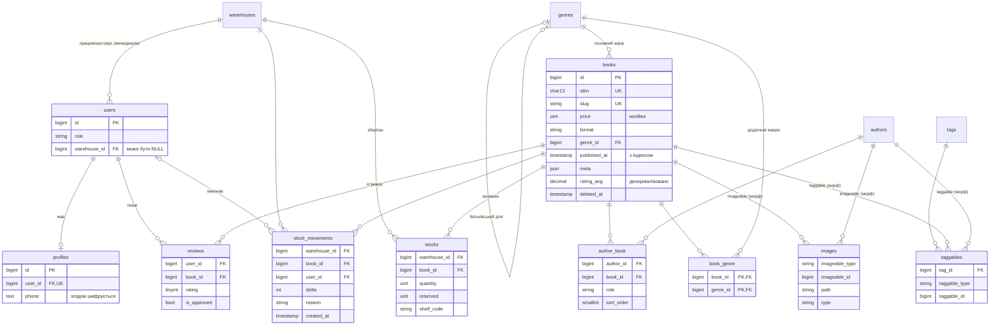

# 01 — Схема БД, моделі, фабрики та сидери

## Мета

Спроєктувати базу даних складу (14 таблиць, включно з проміжними та поліморфними), відобразити її
на моделі Eloquent із PHP-атрибутами Laravel 13 і згенерувати реалістичні демонстраційні дані у
двох масштабах: швидкий `small` для щоденної роботи та `full` (~50 тис. книг, ~200 тис. відгуків)
для уроків про продуктивність. Зв’язки, аксесори, скоупи тощо з’являться на наступних етапах.

## Де дивитися в коді

- `app/Enums/*` — enum зі строковими значеннями, що зберігаються у звичайних стовпцях `string`;
  метод `label()` повертає перекладену назву.
- `database/migrations/2026_10_15_*` — схема в порядку зовнішніх ключів.
- `app/Models/*` — атрибути `#[Fillable]` / `#[Hidden]`, `casts()`; у `Book` для порівняння
  збережено закоментований старий варіант `protected $fillable`; у `StockMovement` — `UPDATED_AT = null`.
- `database/factories/*` — стани (`manager()`, `admin()`, `published()`, `unpublished()`,
  `format()`, `approved()`, `child()`); `Concerns/GeneratesUniqueValues.php` — ISBN і слаги.
- `database/seeders/*` — порядок у `DatabaseSeeder`, `Support/SeedScale.php`, `Support/BulkInserts.php`.
- `tests/Feature/Database/*` — тести міграцій, фабрик, сидера та унікальних обмежень.

## Ключові поняття

### ER-діаграма



### Гроші — цілі числа в копійках

`books.price` — це `unsigned int` у копійках (`1999` = 19,99 ₴). Числа з рухомою комою не можуть
точно представити більшість десяткових дробів (`0.1 + 0.2 != 0.3`), тож суми й знижки «пливуть».
`DECIMAL` точний, але PDO повертає його рядком, і в PHP все одно спокушає рахувати у float. Цілі
числа точні, швидкі й легко сумуються; форматування — лише під час показу:
`Number::currency($price / 100, in: 'UAH', locale: 'uk')` → «19,99 ₴» (на наступному етапі —
через приведення типів або аксесор).

### Enum у строкових стовпцях

`role`, `format`, `type`, `reason` — це стовпці `string` + PHP backed enum (приведення в
`casts()`), а не нативні `ENUM` бази даних: новий варіант — це зміна коду, а не `ALTER TABLE`, і
все однаково працює в MySQL і SQLite. Людські назви варіантів дає `->label()` з
`lang/{uk,en}/enums.php`.

### Зовнішні ключі: що відбувається під час видалення

| Зовнішній ключ | Правило | Чому |
|---|---|---|
| `profiles.user_id`, `reviews.user_id` | cascade | належать користувачеві; без нього не мають сенсу |
| `reviews.book_id`, `stocks.*`, проміжні таблиці (`author_book`, `book_genre`, `taggables.tag_id`) | cascade | рядки лише описують зв’язок |
| `stock_movements.warehouse_id/book_id` | cascade | журнал залишку, якого вже немає |
| `stock_movements.user_id` | nullOnDelete | історію зберігаємо, автора руху забуваємо |
| `users.warehouse_id` | nullOnDelete | менеджер складу «переживає» закриття складу |
| `genres.parent_id` | nullOnDelete | піджанри стають кореневими жанрами |
| `books.genre_id` | restrictOnDelete | не можна видалити жанр, у якому ще є книги |

Зауважте: `books` використовує **м’яке видалення (soft delete)**, тож звичайний `$book->delete()`
лише заповнює `deleted_at`, і каскади не спрацьовують; вони діють під час `forceDelete()`.

### Індекси

- `books.published_at` — списки каталогу фільтрують і сортують за датою виходу.
- `reviews (book_id, is_approved)` — «схвалені відгуки книги» (сторінка книги, задача
  перерахунку рейтингу). Складений індекс обслуговує й запити лише за `book_id` (лівий префікс).
- `stock_movements (warehouse_id, book_id)` — історія одного залишку.
- `morphs()` додає індекси `(type, id)` до `images` / `taggables`.
- Кожен `foreignId()->constrained()` у MySQL автоматично отримує індекс.

### Унікальні обмеження = бізнес-правила в базі

- `reviews (user_id, book_id)` — один відгук від користувача на книгу.
- `stocks (warehouse_id, book_id)` — один рядок залишку книги на складі.
- `author_book (author_id, book_id, role)` — та сама людина може бути автором *і* перекладачем.
- `taggables (tag_id, taggable_id, taggable_type)`, складений первинний ключ `book_genre`.
- `books.isbn`, `*.slug`, `profiles.user_id` (робить профіль зв’язком «один до одного»).

Валідацію можна обійти (масові вставки, гонки); унікальний індекс — ні.

### Поліморфні (морф-) стовпці

`$table->morphs('imageable')` створює `imageable_type` (рядок: за замовчуванням клас моделі,
наприклад `App\Models\Book`; у цьому проєкті — псевдонім `book` з мапи морфів, див. урок 02) і
`imageable_id` плюс індекс. Одна таблиця `images` обслуговує книги (обкладинки) й авторів (фото);
`taggables` робить те саме для зв’язку «багато до багатьох». База даних не може забезпечити
зовнішній ключ для `imageable_id` (він може вказувати на різні таблиці) — цілісність лежить на
застосунку.

### Атрибути моделей у Laravel 13

```php
#[Fillable(['title', 'slug', /* ... */])]
class Book extends Model
{
    // Legacy syntax (Laravel <= 12):
    // protected $fillable = ['title', 'slug', /* ... */];
}
```

### Сидери великого обсягу

- `SEED_SCALE=small|full` (`config('database.seed_scale')`). У Sail передайте змінну в контейнер:
  `docker compose exec -e SEED_SCALE=full laravel.test php artisan migrate:fresh --seed`
  (або задайте її в `.env`).
- Великі таблиці заповнюються **порційними вставками через Query Builder** (1000 рядків на
  запит) у транзакціях; `Factory::raw()` дає змогу перевикористати визначення фабрик, не створюючи
  моделей. Зовнішні ключі передаються в `raw()` явно, щоб він не створював пов’язані моделі через
  `Model::factory()`.
- ISBN і слаги беруться з лічильника в межах процесу (`GeneratesUniqueValues`), а не з
  `faker->unique()`, який на 50 тис. рядків сповільнюється і кидає винятки через колізії.
- Дані українською: Faker `uk_UA` (імена, міста, адреси), назви книг — `realText()` з
  українського корпусу Faker, тексти відгуків — з пулу заздалегідь згенерованих текстів (бо
  `realText()` коштує ~0,5 мс, а відгуків 200 тис.). Слаги — лише ASCII:
  `Str::slug($value, '-', 'uk')`.
- Повний сидинг: ~85 с на Sail/MySQL (див. таблицю в підсумку етапу 1; з українськими назвами
  книг — трохи довше).

## Вправа

1. Додайте таблицю `publishers` (назва, країна) і зробіть `books.publisher_id` зовнішнім ключем,
   що може бути NULL. Оберіть правило під час видалення й обґрунтуйте його в коментарі.
2. Спробуйте вставити дублікат відгуку в tinker і подивіться на `UniqueConstraintViolationException`.
3. Заміряйте `Review::factory()->count(5000)->create()` проти масового підходу в `ReviewSeeder` для
   тієї самої кількості рядків. Запишіть обидва числа — повернемося до них на етапі 5.
