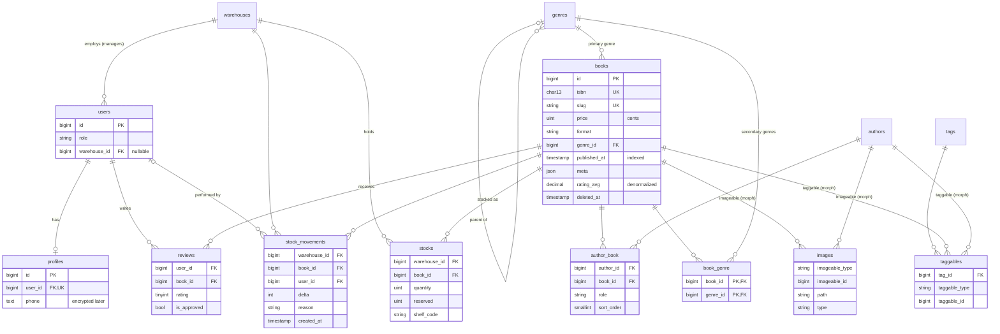

# 01 — Database schema, models, factories & seeders

## Goal

Design the warehouse database (14 tables, including pivots and polymorphic tables), map it to
Eloquent models with Laravel 13 PHP attributes, and generate realistic demo data at two scales:
a fast `small` seed for everyday work and a `full` seed (~50k books, ~200k reviews) for the
performance lessons. Relationships, accessors, scopes etc. come in later stages.

## Where to look in code

- `app/Enums/*` — string-backed enums stored in plain `string` columns.
- `database/migrations/2026_10_15_*` — schema, in foreign-key order.
- `app/Models/*` — `#[Fillable]` / `#[Hidden]` attributes, `casts()`; `Book` keeps the legacy
  `protected $fillable` commented for comparison; `StockMovement` has `UPDATED_AT = null`.
- `database/factories/*` — states (`manager()`, `admin()`, `published()`, `unpublished()`,
  `format()`, `approved()`, `child()`); `Concerns/GeneratesUniqueValues.php` for ISBN/slugs.
- `database/seeders/*` — `DatabaseSeeder` order, `Support/SeedScale.php`, `Support/BulkInserts.php`.
- `tests/Feature/Database/*` — migrations, factories, seeder and unique-constraint tests.

## Key concepts

### ER diagram



### Money as integer cents

`books.price` is `unsigned int` holding cents (`1999` = $19.99). Floats can't represent most
decimal fractions exactly (`0.1 + 0.2 != 0.3`), so sums and discounts drift. `DECIMAL` is exact
but is returned as a string by PDO and still tempts float math in PHP. Integers are exact, fast
and trivially summed; formatting happens only when displaying (a cast/accessor in a later stage).

### Enums in string columns

`role`, `format`, `type`, `reason` are `string` columns + PHP backed enums (cast in `casts()`),
not native DB `ENUM`s: adding a case is a code change, not an `ALTER TABLE`, and it works the
same on MySQL and SQLite.

### Foreign keys: what happens on delete

| FK | Rule | Why |
|---|---|---|
| `profiles.user_id`, `reviews.user_id` | cascade | owned by the user; meaningless without it |
| `reviews.book_id`, `stocks.*`, pivots (`author_book`, `book_genre`, `taggables.tag_id`) | cascade | rows only describe the link |
| `stock_movements.warehouse_id/book_id` | cascade | ledger of a stock that no longer exists |
| `stock_movements.user_id` | nullOnDelete | keep the history, forget who did it |
| `users.warehouse_id` | nullOnDelete | a manager survives warehouse closure |
| `genres.parent_id` | nullOnDelete | children become root genres |
| `books.genre_id` | restrictOnDelete | can't delete a genre that still has books |

Note: `books` uses **soft deletes**, so a normal `$book->delete()` only sets `deleted_at` and
cascades never fire; they apply on `forceDelete()`.

### Indexes

- `books.published_at` — catalog lists filter/sort by publication date.
- `reviews (book_id, is_approved)` — "approved reviews of a book" (book page, rating job). The
  composite also serves queries on `book_id` alone (left-most prefix).
- `stock_movements (warehouse_id, book_id)` — history of one stock row.
- `morphs()` adds `(type, id)` indexes on `images` / `taggables`.
- Every `foreignId()->constrained()` gets an index on MySQL automatically.

### Unique constraints = business rules in the DB

- `reviews (user_id, book_id)` — one review per user per book.
- `stocks (warehouse_id, book_id)` — one stock row per book per warehouse.
- `author_book (author_id, book_id, role)` — the same person can be author *and* translator.
- `taggables (tag_id, taggable_id, taggable_type)`, `book_genre` composite primary key.
- `books.isbn`, `*.slug`, `profiles.user_id` (makes profile one-to-one).

Validation can be bypassed (bulk inserts, race conditions); a unique index cannot.

### Polymorphic (morph) columns

`$table->morphs('imageable')` creates `imageable_type` (string, the model class, e.g.
`App\Models\Book`) and `imageable_id` plus an index. One `images` table serves books (covers)
and authors (photos); `taggables` does the same for many-to-many. The DB can't enforce a FK on
`imageable_id` (it may point to different tables) — integrity is the application's job.

### Laravel 13 model attributes

```php
#[Fillable(['title', 'slug', /* ... */])]
class Book extends Model
{
    // Legacy syntax (Laravel <= 12):
    // protected $fillable = ['title', 'slug', /* ... */];
}
```

### Seeding at scale

- `SEED_SCALE=small|full` (`config('database.seed_scale')`). Inside Sail pass it to the
  container: `docker compose exec -e SEED_SCALE=full laravel.test php artisan migrate:fresh --seed`
  (or set it in `.env`).
- Big tables are filled with **chunked Query Builder inserts** (1000 rows per statement) inside
  transactions, using `Factory::raw()` to reuse factory definitions without creating models.
  Explicit FKs are passed to `raw()` so it doesn't create related models via `Model::factory()`.
- ISBNs and slugs come from a per-process counter (`GeneratesUniqueValues`) instead of
  `faker->unique()`, which gets slow and throws on collisions at 50k rows.
- Full seed: ~85 s on Sail/MySQL (see the table in the stage 1 summary).

## Exercise

1. Add a `publishers` table (name, country) and make `books.publisher_id` a nullable FK. Choose
   the on-delete rule and justify it in a comment.
2. Try inserting a duplicate review in tinker and observe `UniqueConstraintViolationException`.
3. Time `Review::factory()->count(5000)->create()` vs. the bulk approach in `ReviewSeeder` for
   the same number of rows. Write down both numbers — we'll revisit them in stage 5.
